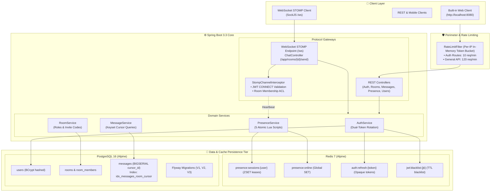

# ChatOps — High-Concurrency Real-Time Collaboration Platform

> **Production-grade real-time messaging and collaboration engine** engineered with **Java 21/25**, **Spring Boot 3.3**, **WebSockets (STOMP)**, **Redis 7** (multi-device presence via 5 atomic Lua scripts), **PostgreSQL 16** (keyset cursor pagination), and an in-memory **Token Bucket rate limiter**. Packaged with multi-stage Docker builds, full **Testcontainers** integration test suites, and **GitHub Actions CI/CD**.

[](https://github.com/ronaksalekar/ChatOps/actions/workflows/ci.yml)
[](https://github.com/ronaksalekar/ChatOps/actions/workflows/cd.yml)
[](https://openjdk.org/)
[](https://spring.io/projects/spring-boot)
[](https://redis.io/)
[](https://www.postgresql.org/)
[](https://www.docker.com/)
[](LICENSE)
---

## ⚡ Executive Summary: Problems Solved

Traditional chat systems fail at scale due to 4 classic concurrency and database bottlenecks. ChatOps is engineered specifically to eliminate them:

| Challenge | The Naive Approach (Fails at Scale) | ChatOps Engineering Solution | Advantage |
| :--- | :--- | :--- | :--- |
| **Multi-Device Presence** | Single boolean `is_online` flag in DB; closing one browser tab marks the user offline everywhere. | **Redis Sorted Sets (`ZSET`)** per user tracking individual session leases + **5 atomic Lua scripts**. | **Zero race conditions**, instant multi-tab sync, zero phantom presence. |
| **Message History Pagination** | SQL `OFFSET / LIMIT` scans and discards $O(N)$ index rows; new messages cause page drift and duplicate cards. | **Keyset Cursor Pagination** (`WHERE cursor_id < :cursor ORDER BY cursor_id DESC LIMIT :n`). | **$O(1)$ constant-time traversal** via composite B-Tree index `(room_id, cursor_id DESC)`. |
| **WebSocket Security & Snooping** | Unchecked WebSocket brokers allow unauthenticated connections and cross-room eavesdropping. | **STOMP Channel Interceptor** validating JWT on `CONNECT` and verifying room membership on every `SUBSCRIBE` / `SEND`. | **Zero-trust message routing**; rogue subscribers are instantly rejected. |
| **DDoS & Brute Force** | Open authentication endpoints vulnerable to credential stuffing and noisy-neighbor starvation. | Custom thread-safe per-IP **Token Bucket filter** (`RateLimitFilter`) with dual-tier thresholds. | Auth protected at **10 req/min**; general APIs capped at **120 req/min**. |

---

## 🏛️ System Architecture

### Visual Flow (Mermaid)



### Component Topology (ASCII)

```
                                  ┌─────────────────────────────────────────┐
                                  │   Clients (Web UI / Mobile / STOMP)     │
                                  └────────────────────┬────────────────────┘
                                                       │ HTTP / WebSocket (:8080)
┌──────────────────────────────────────────────────────┼──────────────────────────────────────────────────────┐
│ Spring Boot 3.3 Core Application                     ▼                                                      │
│ ┌─────────────────────────────────────────────────────────────────────────────────────────────────────────┐ │
│ │  RateLimitFilter (Per-IP Token Bucket: Auth = 10 req/min, General API = 120 req/min)                    │ │
│ └────────────────────────────────────────────────────┬────────────────────────────────────────────────────┘ │
│                                                      │                                                      │
│         ┌────────────────────────────────────────────┴────────────────────────────────────────────┐         │
│         ▼                                                                                         ▼         │
│  [REST Controllers]                                                                   [STOMP WebSocket]    │
│  • AuthController (/api/auth)                                                         • /ws SockJS Handshake│
│  • RoomController (/api/rooms)                                                        • StompChannelInter-  │
│  • MessageController (/api/rooms/{id}/messages)                                         ceptor (JWT Auth +  │
│  • PresenceController (/api/presence)                                                   Room Membership)    │
│  • UserController (/api/users)                                                        • ChatController      │
│         │                                                                                         │         │
│         └─────────────────────────────────────┬───────────────────────────────────────────────────┘         │
│                                               ▼                                                             │
│                                   [Application Service Layer]                                               │
│                         (AuthService, RoomService, MessageService, PresenceService)                         │
└───────────────────────────────────────────────┬─────────────────────────────────────────────────────────────┘
                                                │
                     ┌──────────────────────────┴──────────────────────────┐
                     ▼                                                     ▼
    ┌───────────────────────────────────┐               ┌───────────────────────────────────┐
    │              Redis 7              │               │           PostgreSQL 16           │
    ├───────────────────────────────────┤               ├───────────────────────────────────┤
    │ • presence:online (Global SET)    │               │ • users (id, username, password)  │
    │ • presence:sessions:<user> (ZSET) │               │ • rooms (id, invite_code, owner)  │
    │ • 5 Atomic Lua Scripts            │               │ • room_members (role, composite)  │
    │ • auth:refresh:<token> (Opaque)   │               │ • messages (BIGSERIAL cursor_id,  │
    │ • jwt:blacklist:<jti> (TTL cache) │               │   idx_messages_room_cursor)       │
    │ • Sub-second heartbeat leases     │               │ • Flyway Migration History        │
    └───────────────────────────────────┘               └───────────────────────────────────┘
```

---

## 🔬 Key Engineering Features & Design Decisions

### 1. Why Redis Sorted Sets (`ZSET`) + 5 Atomic Lua Scripts?
- **The Problem**: A single user often opens multiple browser tabs or devices. A naive boolean flag marks the user offline if any tab closes, creating presence thrashing and split-brain state.
- **The Design**:
  - `presence:sessions:<username>`: A **Sorted Set (ZSET)** where each member is an active WebSocket `sessionId` and its score is the epoch expiration timestamp (`now + 90s`).
  - `presence:online`: A **Set** containing all usernames that have at least one active, non-expired session.
- **Why Atomic Lua Scripts**: Running multi-key operations from Java requires distributed locks or multiple network round trips. ChatOps executes all transitions in **5 atomic Lua scripts**:
  1. `ADD_SESSION`: Prunes expired sessions (`ZREMRANGEBYSCORE`), registers the session, adds user to `presence:online`. Returns `1` only if the user transitioned from 0 live sessions to 1 (triggering an `ONLINE` broadcast).
  2. `REMOVE_SESSION`: Removes the disconnecting session, prunes expired leases, and checks `ZCARD`. If zero live sessions remain, removes user from `presence:online` and returns `1` (triggering an `OFFLINE` broadcast).
  3. `REFRESH_SESSION`: Heartbeat renewal invoked automatically as STOMP frames flow through the channel interceptor.
  4. `REFRESH_USER_SESSIONS`: REST fallback renewing all active sessions for a user upon polling `/api/presence/heartbeat`.
  5. `EVICT_EXPIRED`: Sweeper script ensuring zombie connections from ungraceful client crashes are evicted cleanly.
- **Result**: Zero race conditions, atomic single-round-trip execution, sub-millisecond response.

### 2. Why Keyset Cursor Pagination ($O(1)$ vs $O(N)$ OFFSET)?
- **The Problem**: Traditional `LIMIT 50 OFFSET 10000` forces the database engine to scan 10,050 index tuples and discard 10,000, causing disk I/O thrashing on large chat rooms. Furthermore, when new messages are inserted during scrolling, offset pagination results in missed messages or duplicate cards ("page drift").
- **The Design**:
  ```sql
  SELECT * FROM messages
  WHERE room_id = :roomId
    AND cursor_id < :beforeCursor
  ORDER BY cursor_id DESC
  LIMIT :limit;
  ```
  - Backed by composite B-Tree index: `CREATE INDEX idx_messages_room_cursor ON messages (room_id, cursor_id DESC);`
  - `cursor_id` is an auto-incrementing `BIGSERIAL` monotonically ordered by arrival.
- **Result**: Direct index lookup in $O(\text{limit})$, zero disk table scan overhead, completely immune to concurrent writes and page drift.

### 3. Why Docker & Docker Compose (Multi-Stage Builds & Isolation)?
- **The Problem**: Real-time collaborative backends have tight infrastructure dependencies (PostgreSQL 16 extensions, Redis 7 Alpine configuration, JDK 21+ bytecode). Setting up local databases manually leads to version mismatches, missing schemas, and fragile onboarding.
- **The Design**:
  - **Single-Command Orchestration**: `docker-compose.yml` spins up PostgreSQL 16 Alpine, Redis 7 Alpine, and the Spring Boot application on an isolated bridge network with automated health checks (`pg_isready`, `redis-cli ping`, `/actuator/health`).
  - **Optimized Multi-Stage `Dockerfile`**:
    - *Stage 1 (Builder)*: Uses `eclipse-temurin:25-jdk-alpine`, pre-fetching Maven dependencies offline (`mvn dependency:go-offline`) to maximize Docker layer caching before compiling the JAR.
    - *Stage 2 (Runtime)*: Minimal `eclipse-temurin:25-jre-alpine` runtime image, running as a dedicated non-root security user (`chatops:chatops`) with container-aware JVM ergonomics (`-XX:+UseContainerSupport -XX:MaxRAMPercentage=75.0`).
- **Result**: 100% reproducible environments for developers and interviewers; lightweight production runtime images (< 250 MB) without compiler bloat.

### 4. Security Architecture: Dual JWT Lifecycle & Instant Revocation
- **The Problem**: Pure stateless JWTs cannot be revoked immediately upon logout without database queries on every HTTP request.
- **The Design**:
  - **Access Tokens**: Short-lived (1 hour) stateless JWT signed with HMAC-SHA256, carrying user claims (`userId`, `email`, `sub`) for instant validation.
  - **Refresh Tokens**: Cryptographically secure 32-byte opaque tokens (`SecureRandom`, Base64 URL-safe) stored in Redis with 7-day TTL (`auth:refresh:<token>`).
  - **Single-Use Rotation**: Refreshing an access token revokes the old refresh token immediately and issues a new pair, eliminating token replay vectors.
  - **Instant Logout (Redis Blacklist)**: Calling `/api/auth/logout` revokes the refresh token and writes the active JWT `jti` to `jwt:blacklist:<jti>` in Redis with the token's remaining TTL.
  - **Zero-Trust WebSocket Interception**: `StompChannelInterceptor` validates JWT signatures during the STOMP `CONNECT` frame and verifies room membership before allowing any topic subscription (`/topic/rooms/{id}`) or message broadcast (`/app/rooms/{id}/send`).

### 5. Custom Thread-Safe Token Bucket Rate Limiting
- Implemented as a native servlet filter (`RateLimitFilter`) directly in the HTTP pipeline:
  - Per-client-IP `SimpleTokenBucket` with synchronized fractional token refills.
  - Resolves true client IPs across proxies via `X-Forwarded-For` and `X-Real-IP`.
  - **Auth Tier** (`/api/auth/**`): 10 req/min (mitigates brute-force login and credential stuffing).
  - **API Tier** (All other endpoints): 120 req/min (prevents resource starvation from runaway clients).

---

## 🛠️ Tech Stack Matrix

| Domain | Technology | Version | Key Engineering Rationale |
| :--- | :--- | :--- | :--- |
| **Language** | Java | 21 / 25 | Virtual threads ready, records, pattern matching, high memory efficiency |
| **Framework** | Spring Boot | 3.3.4 | Mature DI, Spring Security 6, Spring Data JPA, Actuator observability |
| **Real-Time** | Spring WebSocket + STOMP | SockJS | Full-duplex messaging with SockJS fallback and destination routing |
| **In-Memory Store** | Redis | 7-Alpine | Sub-millisecond latency, sorted sets for multi-device presence, Lua scripting |
| **Relational DB** | PostgreSQL | 16-Alpine | ACID reliability, composite B-Trees for keyset cursor pagination |
| **DB Migrations** | Flyway | Latest | Deterministic, version-controlled database schema migrations |
| **Security** | JJWT | 0.12.6 | RFC 7519 compliant dual-token JWT lifecycle + Redis blacklisting |
| **Containerization**| Docker & Docker Compose | Multi-stage | Builder/runtime split, non-root user, container RAM ergonomics |
| **Testing** | Testcontainers | 1.20.1 | Ephemeral Postgres 16 & Redis 7 containers for zero-mock integration testing |
| **CI/CD** | GitHub Actions | v4 / v6 | Automated test matrix, multi-arch GHCR publishing, Render webhook CD |
| **API Docs** | SpringDoc / OpenAPI 3 | 2.6.0 | Interactive Swagger UI documentation at `/swagger-ui.html` |

---

## 🚀 Quick Start Guide

### Prerequisites
- [Docker Desktop](https://www.docker.com/products/docker-desktop/) (Docker Engine + Docker Compose)
- JDK 21+ and Maven (optional, only needed if compiling outside Docker)

### Option 1: 1-Command Startup with Docker Compose (Recommended)

```bash
# 1. Clone the repository
git clone https://github.com/ronaksalekar/ChatOps.git
cd ChatOps

# 2. Initialize environment configuration
cp .env.example .env

# 3. Spin up PostgreSQL, Redis, and ChatOps Backend
docker compose up --build -d

# 4. Verify running health status
docker compose ps
```

The application is immediately accessible at:
- 💬 **Interactive Web Chat UI**: [http://localhost:8080/](http://localhost:8080/) *(Full real-time chat with rooms, presence, and typing indicators)*
- 🩺 **Actuator Health Check**: [http://localhost:8080/actuator/health](http://localhost:8080/actuator/health)
- 🔌 **WebSocket / STOMP Endpoint**: `ws://localhost:8080/ws`

> **Note on Swagger UI**: Swagger UI is enabled out-of-the-box in the `dev` profile (`http://localhost:8080/swagger-ui.html`). To enable it in Docker, simply ensure `SPRING_PROFILES_ACTIVE=dev` in your `.env` file.

### Option 2: Running Locally for Development

```bash
# 1. Spin up only the backing databases
docker compose up -d postgres redis

# 2. Run the application with 'dev' profile (enables Swagger UI & verbose SQL)
# Linux / macOS:
./mvnw spring-boot:run -Dspring-boot.run.profiles=dev

# Windows (PowerShell):
.\mvnw.cmd spring-boot:run -Dspring-boot.run.profiles=dev
```

- **Interactive Swagger UI**: [http://localhost:8080/swagger-ui.html](http://localhost:8080/swagger-ui.html)
- **Built-in Web Client**: [http://localhost:8080/](http://localhost:8080/)

---

## 🧪 Testing & Verification

ChatOps employs a comprehensive pyramid testing strategy:

```bash
# Run unit tests (JwtService, PresenceService Lua mocks)
# Note: In Windows PowerShell, quote the parameter:
.\mvnw.cmd test "-Dtest=JwtServiceTest,PresenceServiceTest"

# Run full integration test suite with Testcontainers (requires Docker Desktop running)
.\mvnw.cmd verify
```

### Integration Testing with Testcontainers
Integration test suites inherit from `AbstractIntegrationTest`, which spins up real, ephemeral **PostgreSQL 16-alpine** and **Redis 7-alpine** containers via `@DynamicPropertySource`. This validates real SQL constraints, Flyway migrations, and Redis Lua scripts without mock drift.

---

## 📋 Core API & WebSocket Reference

### 1. REST Endpoints Summary

| Group | Method | Path | Description | Auth Required | Rate Limit |
| :--- | :--- | :--- | :--- | :---: | :---: |
| **Auth** | `POST` | `/api/auth/register` | Register new user account | No | 10 / min |
| **Auth** | `POST` | `/api/auth/login` | Authenticate and obtain JWT token pair | No | 10 / min |
| **Auth** | `POST` | `/api/auth/refresh` | Exchange refresh token for new access token | No | 10 / min |
| **Auth** | `POST` | `/api/auth/logout` | Revoke refresh token and blacklist access JWT | Yes | 10 / min |
| **Users**| `GET` | `/api/users/me` | Fetch authenticated user profile | Yes | 120 / min |
| **Rooms**| `POST` | `/api/rooms` | Create a new chat room | Yes | 120 / min |
| **Rooms**| `GET` | `/api/rooms` | List rooms current user is a member of | Yes | 120 / min |
| **Rooms**| `GET` | `/api/rooms/public` | List all available public rooms | Yes | 120 / min |
| **Rooms**| `GET` | `/api/rooms/{id}` | Get room metadata (membership verified) | Yes | 120 / min |
| **Rooms**| `POST` | `/api/rooms/join` | Join private or public room via unique invite code | Yes | 120 / min |
| **Rooms**| `POST` | `/api/rooms/{id}/invite`| Invite user to room by username | Yes | 120 / min |
| **Rooms**| `POST` | `/api/rooms/{id}/join` | Join a public room directly | Yes | 120 / min |
| **Rooms**| `DELETE`| `/api/rooms/{id}/leave`| Leave room membership | Yes | 120 / min |
| **Rooms**| `DELETE`| `/api/rooms/{id}` | Delete room (creator/admin only) | Yes | 120 / min |
| **Msgs** | `GET` | `/api/rooms/{id}/messages` | Keyset cursor history (`?before=<id>&limit=<n>`) | Yes | 120 / min |
| **Pres** | `GET` | `/api/presence/online` | List all globally online usernames | Yes | 120 / min |
| **Pres** | `GET` | `/api/presence/rooms/{id}` | Bulk query online presence for room members | Yes | 120 / min |
| **Pres** | `POST` | `/api/presence/heartbeat` | Renew presence lease TTL | Yes | 120 / min |

### 2. WebSocket & STOMP Protocol (`/ws`)

Connect to `ws://localhost:8080/ws` over SockJS. Pass the access token in the STOMP `CONNECT` frame header:
```http
CONNECT
Authorization:Bearer <your-access-jwt>
accept-version:1.2,1.1,1.0
```

#### Channels & Destinations:

| Type | Destination | Payload Structure | Purpose |
| :--- | :--- | :--- | :--- |
| **Publish** | `/app/rooms/{id}/send` | `{"content": "Hello team!"}` | Send chat message to room |
| **Publish** | `/app/rooms/{id}/typing` | *(Empty)* | Broadcast ephemeral typing indicator |
| **Subscribe**| `/topic/rooms/{id}` | `MessageResponse` JSON | Receive incoming chat messages |
| **Subscribe**| `/topic/rooms/{id}/typing` | `{"roomId": 1, "username": "alice", "timestamp": ...}` | Receive typing indicators |
| **Subscribe**| `/topic/rooms/{id}/presence`| `{"username": "alice", "status": "ONLINE"}` | Real-time presence status changes |
| **Subscribe**| `/user/queue/errors` | `{"error": "You are not a member of room 1"}` | Private error alerts to caller |

---

## 🚢 Production & DevOps Readiness

### Multi-Stage Docker Build
ChatOps utilizes an optimized two-stage `Dockerfile`:
- **Stage 1 (Builder)**: `eclipse-temurin:25-jdk-alpine` pre-fetches dependencies offline (`mvn dependency:go-offline`) to leverage Docker layer caching, then compiles the executable JAR.
- **Stage 2 (Runtime)**: `eclipse-temurin:25-jre-alpine` packages a minimal footprint runtime image with:
  - Non-root security user (`chatops:chatops`).
  - Container-aware JVM ergonomics: `-XX:+UseContainerSupport -XX:MaxRAMPercentage=75.0`.
  - Health checks querying `/actuator/health`.

### CI/CD Pipeline
- **CI (`ci.yml`)**: Triggers on push and pull requests. Sets up JDK 21, caches Maven repository layers, runs `./mvnw -B verify` with Testcontainers, uploads surefire test reports, and on `main` pushes builds and publishes Docker images to **GitHub Container Registry (`ghcr.io`)**.
- **CD (`cd.yml`)**: On successful completion of the CI pipeline on `main`, automatically calls the Render deploy hook (`DEPLOY_HOOK_URL`) for zero-downtime production deployment.

---

## 📂 Repository Directory Layout

```
ChatOps/
├── .github/workflows/          # Automated CI/CD workflows (ci.yml, cd.yml)
├── src/
│   ├── main/
│   │   ├── java/com/chatops/
│   │   │   ├── auth/           # JWT token generation, refresh rotation, security filter
│   │   │   ├── config/         # SecurityConfig, RedisConfig, WebSocketConfig, RateLimitFilter
│   │   │   ├── exception/      # Global controller advice, RFC-7807 error responses
│   │   │   ├── message/        # Message entities, keyset pagination queries, service
│   │   │   ├── presence/       # PresenceService (5 atomic Lua scripts), PresenceController
│   │   │   ├── room/           # Room management, role access control, invite codes
│   │   │   ├── user/           # User JPA entity, UserDetailsService
│   │   │   └── websocket/      # ChatController, StompChannelInterceptor, WebSocketEventListener
│   │   └── resources/
│   │       ├── db/migration/   # Flyway migrations (V1__init_schema, V2, V3__add_room_invite_code)
│   │       ├── static/         # 💬 Built-in Web Client (index.html)
│   │       ├── logback-spring.xml # Structured logging configuration
│   │       └── application.yml # Base, dev, test, and prod profile configurations
│   └── test/                   # Testcontainers integration tests & unit suites
├── .env.example                # Template for environment configuration
├── Dockerfile                  # Lean multi-stage Docker build (Alpine builder + JRE runtime)
├── docker-compose.yml          # Local orchestration (PostgreSQL 16 + Redis 7 + ChatOps)
├── ChatOps_Comprehensive_Engineering_Report_and_Interview_Guide.pdf # 📘 Interview Guide
├── pom.xml                     # Maven project descriptor
├── LICENSE                     # MIT License
└── README.md                   # Project documentation
```
## 📜 License

This project is licensed under the MIT License — see the [LICENSE](LICENSE) file for details.
